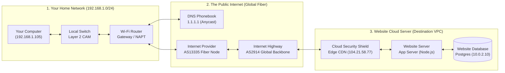

# NetFlow

<div align="center">

[](https://react.dev/)
[](https://vitejs.dev/)
[](https://expressjs.com/)
[](https://vitest.dev/)
[](LICENSE)

**Every request has a journey. Explore every millisecond.**

An interactive, cinematic, and technically rigorous Computer Networks educational observatory.

[Explore Repository](https://github.com/Friedayy/net-flow) • [Quickstart](#-getting-started) • [Architecture](#%EF%B8%8F-architecture-overview) • [Git Push Guide](#-pushing-to-github)

</div>

---

## 📖 Overview

**NetFlow** transforms abstract networking theory into a tangible, observable experience. When you enter a web address into a browser, an intricate chain of distributed protocols and hardware devices coordinate across the globe in milliseconds.

NetFlow traces every phase of this lifecycle:
- **DNS Resolution**: Local cache lookup, recursive queries to `1.1.1.1`, authoritative resolution, and TTL expiration.
- **Local Network (LAN)**: ARP frame broadcasts, Layer 2 Ethernet frame encapsulation, switch CAM table learning.
- **Home Gateway**: Stateful NAPT (Network Address & Port Translation) and private-to-public IP mapping.
- **Global Fiber Backbone**: BGP Autonomous System routing (Tier-1 transit providers), TTL decrements, optical fiber propagation delay.
- **Edge Security Shield**: Cloudflare/CDN Anycast reverse proxying and TLS 1.3 cryptographic key exchange (ECDHE / AES-256-GCM).
- **Application Server & Database**: Express REST routing dispatch, PostgreSQL private subnet queries, HTTP serialization, and 200 OK responses.

---

## 🌟 Visual Identity & Aesthetics

NetFlow is designed with a sleek, minimalist digital observatory aesthetic:
- **Backgrounds**: Deep midnight navy surfaces (`#05070c`, `#090d16`, `#0f1523`) with subtle glassmorphism blur.
- **Packet Trails**: Electric cyan (`#00f0ff`) and ice-blue (`#38bdf8`) animated SVG paths with velocity-adjusted glow filters.
- **Cryptographic Security**: Restrained violet highlights (`#a855f7`, `#818cf8`) for TLS handshakes and key negotiations.
- **State Feedback**: Emerald green (`#10b981`) for successful responses, warm amber (`#f59e0b`) for retransmissions/warnings, and coral red (`#ef4444`) for packet drops and TCP RST flags.
- **Typography**: Clean modern typography paired with JetBrains Mono for hex byte offsets and IP routing tables.

---

## 🏗️ Architecture Overview



### Decoupled Simulation & UI Engine

```
Net-flow/
├── server/                              # Real Express demonstration backend
│   ├── index.ts                         # REST API, health probes, SSRF guard
│   └── data.ts                          # Deterministic product mock database
├── src/
│   ├── app/
│   │   └── App.jsx                      # Main application coordinator & state
│   ├── components/
│   │   ├── common/
│   │   │   └── HoverTooltip.jsx         # Viewport-safe portal hover tooltips
│   │   ├── layout/
│   │   │   ├── Header.jsx               # Navigation bar & global status
│   │   │   └── MobileNotice.jsx         # Friendly responsive desktop notice
│   │   └── features/
│   │       ├── launcher/                # URL bar & curated preset scenarios
│   │       ├── network-canvas/          # Interactive SVG canvas, pan/zoom, nodes
│   │       ├── component-inspector/     # Dual-mode device inspector (Simple vs Engineer)
│   │       ├── packet-inspector/        # 4-layer OSI breakdown & Wireshark hex
│   │       ├── stepper/                 # Event step bar with instant scrubber
│   │       ├── timeline/                # Playback controls, metrics & timeline
│   │       ├── telemetry/               # Live network event console stream
│   │       ├── failure-lab/             # Interactive network anomaly lab
│   │       ├── topic-modal/             # Comprehensive RFC & mental model drawer
│   │       ├── learning/                # Guided tours, walkthroughs & glossary
│   │       ├── real-api/                # Live HTTP execution against port 3001
│   │       └── settings/                # Protocol parameters & latency settings
│   ├── engine/                          # Deterministic network simulation engine
│   │   ├── simulator.js                 # Event log generation from request targets
│   │   ├── topology.js                  # Graph topology, interfaces, routing tables
│   │   ├── encapsulation.js             # 4-layer frame builder & hex dump generator
│   │   ├── topicExplainer.js            # RFC citations & mental model registry
│   │   ├── event-scheduler.js           # Playback rate & step state machine
│   │   ├── failures.js                  # Anomaly definitions & recovery steps
│   │   └── types.js                     # Protocol specifications & constants
│   ├── styles/                          # CSS variables, animations, glass panels
│   └── tests/                           # Vitest automated test suite (21 unit tests)
├── public/
│   └── favicon.svg                      # Custom vector telemetry favicon
├── package.json
└── vite.config.ts
```

---

## ⚡ Core Features

### 1. Interactive Topology Canvas
- **Dynamic Camera**: Smooth pan and non-passive wheel/pinch zoom controls with camera presets (*Fit View*, *Your Computer*, *Internet*, *Website Server*).
- **Live Animated Trails**: Electric glowing packet pulses that trace forward journeys, reverse responses, and dropped packets.
- **Viewport-Safe Hover Cards**: Hovering over any device or wire link instantly displays brief specs, portaled directly to the viewport with zero edge clipping.

### 2. Dual-Mode Device Inspector
- **Simple Mode**: Intuitive analogies designed for learners and newcomers.
- **Engineer Mode**:
  - Hardware specifications (ASIC, CPU, OS, buffer sizes).
  - MAC addresses and IPv4/IPv6 interface configurations.
  - Forwarding Information Base (FIB) with longest-prefix matching.
  - Stateful NAPT / PAT translation tables.
  - Layer 2 Switch CAM learning tables.
  - Active socket tables and TCP states (`LISTEN`, `ESTABLISHED`).

### 3. Wire Packet Dissector & Encapsulation
- Inspect real 4-layer encapsulation at every step:
  - **Layer 2 (Data Link)**: Ethernet II frame, Destination MAC, Source MAC, EtherType, CRC32 FCS.
  - **Layer 3 (Network)**: IPv4/IPv6, TTL decrement, Protocol ID, Header Checksum.
  - **Layer 4 (Transport)**: TCP sequence numbers, acknowledgement numbers, flags (`SYN`, `ACK`, `FIN`, `RST`), window sizes, or UDP headers.
  - **Layer 7 (Application)**: HTTP request/response headers, JSON payloads, DNS queries/answers, TLS 1.3 ServerHello parameters.
- **Wireshark-Style Hex Dump**: Byte-offset hexadecimal viewer paired with ASCII representation.

### 4. Interactive Failure Laboratory
Inject and diagnose 8 realistic real-world networking failures:
1. **DNS Resolution Failure**: NXDOMAIN (RCODE 3), DNS recursor failure.
2. **Connection Refused**: Target port closed, kernel returns TCP `[RST, ACK]`.
3. **Packet Loss & TCP Retransmission**: SYN packet dropped, TCP RTO timeout (1000ms), automatic retransmission.
4. **Physical Fiber Cut**: Optical signal loss, ICMP Host Unreachable.
5. **HTTP 404 Route Mismatch**: Network transit succeeds; Express returns 404 application response.
6. **HTTP 500 Internal Error**: Server-side runtime crash.
7. **Database Cluster Outage**: Web server cannot reach PostgreSQL socket (port 5432).
8. **Gateway Timeout**: Backend hang triggering HTTP 504.

Each failure scenario includes **Observed Symptoms**, **Real Diagnostic CLI Commands** (`dig`, `mtr`, `traceroute`, `curl -iv`, `ss`, `tcpdump`), and an **Engineering Recovery Action Plan**.

### 5. Live Demonstration Backend API
NetFlow ships with an integrated Express demonstration backend running on port 3001:
- Real REST API endpoints (`/api/products`, `/api/health`).
- Real HTTP request execution directly from the interface.
- Wall-clock latency benchmarks, real response headers, and wire JSON comparison.
- Explains the architectural boundary between what browser runtimes can access versus low-level packet capture.

---

## 🚀 Getting Started

### Prerequisites
- **Node.js** >= 20.0.0
- **npm** >= 10.0.0

### Installation

Clone the repository using your preferred method:

```bash
# Clone using HTTPS
git clone https://github.com/Friedayy/net-flow.git
cd net-flow

# Or clone using SSH
git clone git@github.com:Friedayy/net-flow.git
cd net-flow
```

Install dependencies:
```bash
npm install
```

### Running Locally

To run both the **Vite frontend** (port 5173) and the **Express demonstration backend** (port 3001) simultaneously:
```bash
npm run start
```

Visit the application in your browser:
```
http://localhost:5173
```

### Individual Commands

| Command | Description |
| :--- | :--- |
| `npm run dev` | Starts the Vite development server only |
| `npm run server` | Starts the Express demonstration backend (port 3001) |
| `npm test` | Runs the Vitest automated test suite |
| `npm run build` | Builds the optimized production bundle into `dist/` |
| `npm run preview` | Previews the production build locally |

---

## 🧪 Automated Testing

NetFlow includes 21 comprehensive automated unit tests covering:
- Deterministic event generation from any URL.
- Cold DNS resolution vs OS resolver cache hits.
- TCP sequence and acknowledgment arithmetic.
- Fault injection termination, packet loss, and recovery paths.
- 4-layer encapsulation assembly and Wireshark hex formatting.
- CIDR routing table longest prefix matching.

Run the test suite:
```bash
npm test
```

---

## 📤 Pushing to GitHub

To push the latest code to your GitHub repository:

```bash
# 1. Initialize Git (if not already initialized)
git init

# 2. Add remote repository
git remote add origin https://github.com/Friedayy/net-flow.git
# Or if using SSH:
# git remote add origin git@github.com:Friedayy/net-flow.git

# 3. Stage all project files
git add .

# 4. Commit changes
git commit -m "feat: complete NetFlow interactive networking observatory"

# 5. Set main branch and push
git branch -M main
git push -u origin main
```

If the remote repository already exists with an initial commit, pull with rebase before pushing:
```bash
git pull origin main --rebase
git push -u origin main
```

---

## 🛡️ Security Considerations

- **SSRF Protection**: All real network probes in the backend are strictly restricted to localhost demonstration endpoints to prevent Server-Side Request Forgery.
- **Safe Simulation**: The simulation engine operates deterministically in pure memory without executing unsanitized raw network commands or opening unrestricted proxy tunnels.

---

## 📄 License

This project is licensed under the [MIT License](LICENSE). Built for students, engineers, and teachers who want to see how the internet really works.
